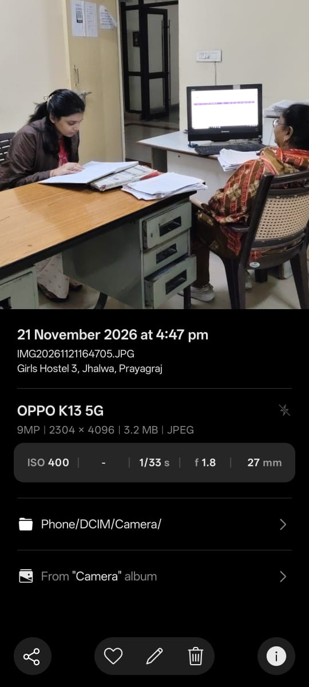
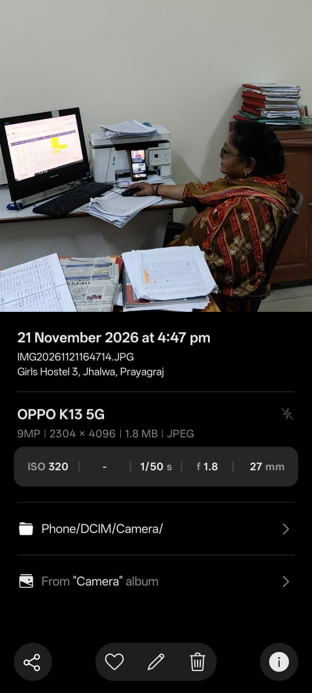
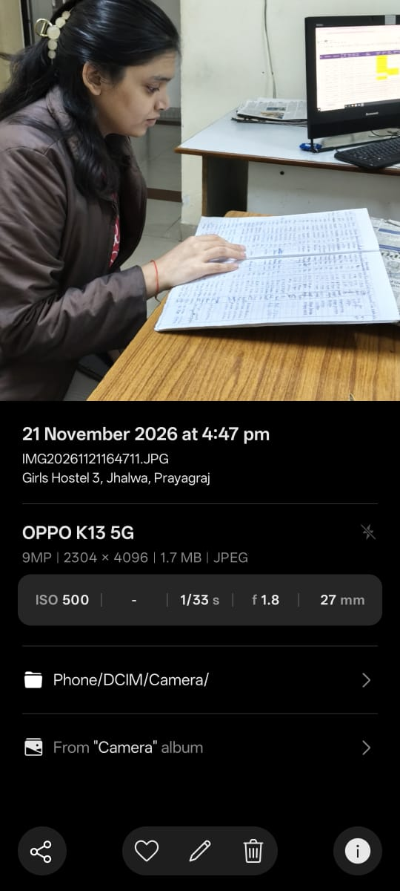

Place : CareTakers's Office, GH-3, IIITA, Prayagraj
Date & Time : November 21, 2026, 4:30 PM to 4:55 PM (Observed on site for 25 minutes)

**Person Spoken To:**
Name: Mrs. Savita 

Role: Hostel Caretaker (manages everything related to the Girls Hostel - 3 including the daily maintenance complaint register and coordinates with visiting plumbers, electricians, and carpenters)

**3 Things She Said :**

The plumber or electrician only visit the hostel on alternate days unless there is a major emergency, so if she misses an entry while flipping through pages, students end up waiting for more days and also return with the same complaints if it remains unresolved."

When a technician visits, he asks her for all pending issues on a single floor / in the same area together so he doesn't have to carry his ladder and toolbox up and down the stairs repeatedly which becomes a hectic and time taking task for her as entries are available in chronological order and she has to filter them manually .

Complaints logged 3 or 4 days ago easily get buried once two new pages of entries are filled in the register.

**1 Thing That Surprised Me:**

After having a look at the register, I initially assumed the caretaker strictly followed the "Urgent" tag written next to complaints in the register. However, she told me that students mark almost every minor issue (like a flickering corridor tube light or slow Wi-Fi) as "Urgent," so she actually ignores the student's urgency tag and prioritizes based on issue category and daily-use/safety impact (such as water leakage, geyser failure, or electrical short circuits) instead.

This made me realize the amount of work that she had to put through this when it could be simplified easily with a tool that prioritizes urgent tasks and also segregates them according to floors making work easier for both the caretaker and the technicians while also ensuring no delays. And according to the caretaker's statement about false urgency, instead of relying only on the urgency column and pending hours, I decided to let the warden decide the urgency.

**How data.csv Was Collected**

With my caretaker's permission, I sat at her for 25 minutes and transcribed 27 real complaint entries from the current physical maintenance register covering the past 11 days.

To protect student privacy, I omitted student names, recording only complaint_id, room numbers, floor, category, urgency, logged_datetime, resolved_datetime, and status.

Natural imperfections from the register—such as missing urgency tags on a few rows and unresolved complaints spanning multiple days were also collected.

## Fieldwork Photos

